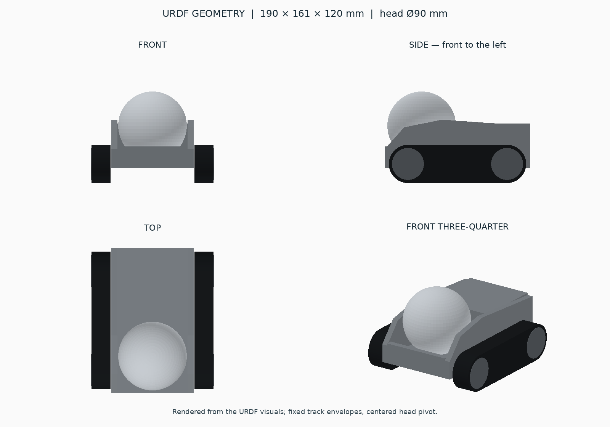

# Compact tracked companion robot

We are building a small tracked robot companion inspired by Anki Vector, with
a distinctive spherical head and a low, compact body. The head is the robot's
main visual feature: it should give the robot the presence of a character while
keeping the mechanical design simple.

## Product concept

- **A large spherical head partially recessed into the body.** Approximately
  half of the sphere sits inside the body, with the rest exposed. Its pitch axis
  passes through the sphere's geometric centre, within the upper body.
- **A low, unified silhouette.** The body supports the head from both sides and
  conceals the mounting mechanism. Recessing the head keeps the robot compact
  and leaves room for the pivot and servo inside the body.
- **Two independently driven tracks as the intended locomotion system.** One
  track sits on each side of the body.
- **An extended rear compartment** for electronics, power, and drive components.
- **No arms, lifting mechanism, or external manipulators.** The character and
  proportions centre on the head and tracked body.

The first engineering model focuses on the head position and depth, body length,
track placement, and overall proportions. Decorative exterior details belong to
a later stage; simplified collision shapes are sufficient for this prototype.

## Current model preview



These views are rendered from the current URDF visuals, not a Gazebo screenshot
or the finished exterior design. The model is approximately **190 x 161 x 120 mm**,
with a **90 mm diameter head**.

## Current development stage

Development currently uses ROS 2 Jazzy and Gazebo Harmonic (Sim 8) on Ubuntu
24.04 in WSL2/WSLg, using **Cyclone DDS** (`rmw_cyclonedds_cpp`) by default. The repository implements the initial geometry and simulation
foundation: body, fixed track envelopes, a passive head pitch joint, a minimal
world, and ROS joint-state/TF integration.

The tracks do not move yet, and the head has no actuator controller. Movement,
head control, camera and sensor integration, and eventually AI behavior are
development directions from the project brief; they are not implemented product
capabilities. Physical hardware integration is also still ahead.

## Current packages

```text
robot_ws/
├── README.md
└── src/
    └── robot_description/
        └── README.md
```

| Package | Responsibility | Context documentation |
| --- | --- | --- |
| `robot_description` | Robot geometry, meshes, link/joint definitions, and the current Gazebo world, launch, and ROS bridge configuration. | [Package README](src/robot_description/README.md) |

`robot_description` is the only ROS 2 package directly under `src/`, so there
are no relationships or dependencies between local packages yet. It integrates
with the external `robot_state_publisher`, `ros_gz_sim`, and `ros_gz_bridge`
packages to spawn the model and expose simulation time, joint states, and TF.
Its README contains the recursive file map, runtime interfaces, dependencies,
geometry details, validation procedures, and limitations.

## Build and run

Run these commands inside WSL **Ubuntu-24.04**:

```bash
source /opt/ros/jazzy/setup.bash
cd ~/robot_ws
source scripts/ros_env.sh
colcon build --base-paths src --packages-select robot_description --symlink-install
source install/setup.bash
ros2 launch robot_description gazebo.launch.py
```

If dependencies are missing, install them from the workspace root before building:

```bash
rosdep install --from-paths src --ignore-src -r -y --rosdistro jazzy
```

For headless simulation, replace the launch command with:

```bash
ros2 launch robot_description gazebo.launch.py gui:=false
```

Source ROS, `scripts/ros_env.sh`, and the workspace setup in each new terminal,
including terminals used for `ros2 topic` and TF inspection. Run one
simulation instance at a time and stop it with Ctrl+C. See the
[package validation commands](src/robot_description/README.md#validation-commands)
for model conversion, ROS topic, and TF checks.

## Automated baseline checks

Run `./scripts/check.sh` for fast conversion, build, installed-resource, and model
contract checks. Run `./scripts/check.sh --full` to also launch one isolated,
headless Gazebo simulation and observe spawning, clock, head joint state, and TF.
Both commands work when called by absolute path from another directory and return
nonzero on failure. Full checks use a 60-second observation deadline and clean up
their own simulation processes. No physical hardware is involved.

Fast pytest cases cover the installed model, child-process RMW selection and the
Cyclone dependency. One Gazebo pytest case checks real runtime integration. Colcon's
summary also counts CTest wrapper results; it is not a count of distinct robot
behaviors. See the [baseline specification](specs/001-robot-description-baseline/spec.md)
and [package coverage](src/robot_description/README.md#validation-commands).

## ROS middleware selection

`scripts/ros_env.sh` exports Cyclone DDS as the project default when
`RMW_IMPLEMENTATION` is unset or empty. `scripts/check.sh` sources it automatically;
manual launches and ROS inspection terminals must source it before starting ROS.
The launch inherits that environment, as does the test observer. No global shell
configuration is changed. An explicit RMW selection is preserved for diagnostics:

```bash
RMW_IMPLEMENTATION=rmw_fastrtps_cpp ./scripts/check.sh --full
```

That diagnostic override is not the validated project default. A missing selected
middleware package fails the check command early; there is no silent fallback.
`rmw_cyclonedds_cpp` is declared as an execution dependency for `rosdep`.

On 2026-11-06, we explicitly used Cyclone DDS for a successful two-process ROS
exchange (81 received strings) and a full project check: 205 `/clock` messages,
202 `/joint_states` messages, all four expected TF paths and cleanup passed.
These were real simulated/ROS messages, with no hardware involved. Earlier
Fast DDS runs received zero messages; its exact failure mechanism remains
unproven. Changing middleware provides a working configuration, not a diagnosis
of the underlying Fast DDS problem. See the package README for current validation.
