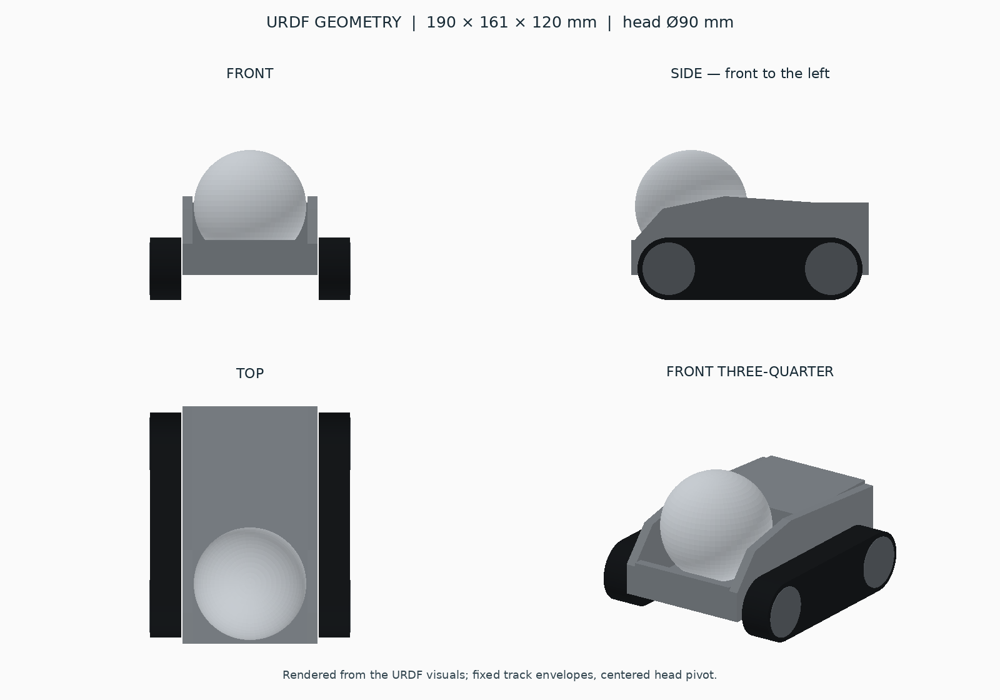

# Compact tracked companion — geometry prototype

Ubuntu 24.04 (WSL2/WSLg), ROS 2 Jazzy, Gazebo Harmonic / Sim 8.
Based on the supplied engineering reference sheet; no decorative shell,
arms, manipulators, sensors, or AI are included.

## Responsibility and ownership

This is the workspace's only active ROS 2 package (`ament_cmake`, version
`0.0.1`). It owns the tracked companion's visual/collision geometry, link and
joint definitions, approximate inertias, mesh assets, and the current minimal
Gazebo launch, world, and ROS bridge configuration.

It does not own a drive controller, head actuator, hardware driver, navigation,
localization, sensor processing, or high-level behavior. There are no custom
C++/Python node classes, composable nodes, public class methods, message/service/
action definitions, Xacro files, or automated tests. The runtime nodes and
Gazebo systems below are external dependencies configured by this package.

## Recursive context map

```text
robot_description/
├── README.md                         Package context, geometry, operation, limitations.
├── package.xml                       Dependencies, Apache-2.0 metadata, resource export.
├── CMakeLists.txt                    Installs urdf/meshes/launch/config/worlds to share/.
├── LICENSE                          Apache License 2.0.
├── config/                          Runtime integration configuration.
│   └── bridge.yaml                  One-way Gazebo-to-ROS clock and joint-state bridges.
├── docs/                            Source-only documentation assets; not installed.
│   └── geometry-preview.png         Render of URDF visuals, not a Gazebo screenshot.
├── include/                         Empty header scaffold; no exported library API.
│   └── robot_description/           Empty package header namespace.
├── launch/                          Simulation orchestration.
│   └── gazebo.launch.py
│       └── generate_launch_description()
│           Resolves installed resources, starts Gazebo, state publisher and bridge,
│           then requests creation of my_robot in world minimal at z=0.02 m.
├── meshes/                          Visual STL assets; collisions use URDF primitives.
│   ├── body_cheek.stl               Reused for left/right head-support cheeks.
│   └── track_envelope.stl           Reused for left/right fixed track envelopes.
├── src/                             Empty source scaffold; no implementation classes.
├── urdf/                            Robot model source; plain URDF, no Xacro expansion.
│   └── robot.urdf                   my_robot geometry, five links, four joints,
│       └── JointStatePublisher      External Gazebo system publishing head_pitch_joint.
└── worlds/                          Self-contained simulation environment.
    └── minimal.sdf                  Gravity, ground plane, directional light, physics,
        ├── Physics                  External Gazebo dynamics system.
        ├── UserCommands             External Gazebo entity-creation system.
        └── SceneBroadcaster         External Gazebo scene publication system.
```

The CMake file builds no executable or library and registers no tests. It requires
CMake 3.8 or newer and `ament_cmake`. The manifest's `gazebo_model_path` export
points at `${prefix}/..` so Gazebo can resolve package mesh resources.

### Runtime nodes, configuration, and interfaces

| Entry | Responsibility and configured inputs |
| --- | --- |
| `generate_launch_description()` | Public ROS launch entry point; returns `LaunchDescription`. Includes `ros_gz_sim/launch/gz_sim.launch.py`, passes the local world, starts simulation immediately, and requests shutdown when the included Gazebo launch exits. |
| `robot_state_publisher/robot_state_publisher` | Reads the URDF text through parameter `robot_description`; uses `use_sim_time=true`; consumes joint states and publishes model transforms. |
| `ros_gz_bridge/parameter_bridge` | Reads parameter `config_file` pointing to `config/bridge.yaml`; uses `use_sim_time=true`; translates the two configured Gazebo topics into ROS messages. |
| `ros_gz_sim/create` | One-shot entity creation executable, using arguments `-world minimal -name my_robot -file <installed URDF> -z 0.02`. It is not a controller. |
| `gz::sim::systems::JointStatePublisher` | Loaded by `robot.urdf` from `gz-sim-joint-state-publisher-system`; selects only `head_pitch_joint` and publishes `/robot/joint_states` on Gazebo Transport. |
| `worlds/minimal.sdf` | SDF 1.9; world `minimal`, gravity `(0, 0, -9.81)`, maximum physics step `0.001` s, target real-time factor `1`, 20 x 20 m ground plane. |

| Interface | Type | Data flow |
| --- | --- | --- |
| ROS `/clock` | `rosgraph_msgs/msg/Clock` | Gazebo `/clock` (`gz.msgs.Clock`) -> bridge -> simulation-time consumers. |
| ROS `/joint_states` | `sensor_msgs/msg/JointState` | Gazebo `/robot/joint_states` (`gz.msgs.Model`) -> bridge -> state publisher; head joint only. |
| ROS `/tf` | `tf2_msgs/msg/TFMessage` | State publisher -> consumers; dynamic `base_link` to `head_link` transform. |
| ROS `/tf_static` | `tf2_msgs/msg/TFMessage` | State publisher -> consumers; fixed footprint and track transforms. |

There are no package-defined ROS services or actions, velocity commands, odometry,
or world/map/odom-to-base TF. External nodes may expose their standard ROS
management interfaces. Gazebo's entity-creation service is used by `create`;
this package defines no service schema or service server.

The only declared launch argument is `gui`, default `true`, accepting `true` or
`false`. It selects `-r` or `-r -s` Gazebo arguments. Dimensions, masses, joint
limits, spawn pose, world, and entity name are currently file-defined values,
not exposed tuning parameters. `bridge.yaml` is the bridge mapping list, not a
general ROS parameter YAML file. No controller parameters exist.

### Dependencies

There are no dependencies on another workspace package. Internally, launch uses
the manifest/CMake-installed URDF, world, and bridge; URDF visuals use the two
meshes. The preview is documentation-only.

Declared build dependency: `ament_cmake`. Declared execution dependencies:
`robot_state_publisher`, `urdf`, `ament_index_python`, `launch`, `launch_ros`,
`ros2launch`, `ros_gz_sim`, `ros_gz_bridge`, `rosgraph_msgs`, and `sensor_msgs`.
The environment additionally supplies Python 3 (`pathlib`), ROS 2 Jazzy, Gazebo
Harmonic / Sim 8 and its systems, `colcon`, and `rosdep`. GUI use requires a
working graphical session such as WSLg. TF inspection below uses `tf2_ros`.

## Build and launch

Inside WSL **Ubuntu-24.04**:

    source /opt/ros/jazzy/setup.bash
    cd ~/robot_ws
    colcon build --packages-select robot_description --symlink-install
    source ~/robot_ws/install/setup.bash
    ros2 launch robot_description gazebo.launch.py

For a server without a GUI:

    ros2 launch robot_description gazebo.launch.py gui:=false

Source both setup files in each new terminal. Run one instance at a time.
Stop with Ctrl+C. If a previous Gazebo server remains after closing launch,
close that instance before launching another model in the same world.

For missing dependencies:

    rosdep install --from-paths src --ignore-src -r -y --rosdistro jazzy

## Geometry and frames

Units: metres, kilograms, radians. +X forward, +Y left, +Z up.
base_footprint and base_link share the nominal ground origin.

| Item | Prototype geometry |
| --- | --- |
| Overall envelope | 190 x 161.2 x 120 mm (160 mm across belts) |
| Head | Sphere diameter 90 mm |
| Head centre / pitch pivot | x=47 mm, y=0, z=75 mm |
| Central body width | 108 mm |
| Track envelopes | 180 x 25 x 50 mm each |
| Track centres | x=0, y=+/-67.5 mm, z=25 mm |
| Nominal ground clearance under floor | 20 mm |
| Total placeholder mass | 1.35 kg |

The rear electronics bay extends from x=-95 to -3 mm.
Two shaped cheeks flank the sphere and cover the pivot height: their inner
faces are at y=+/-46 mm and their top at the pivot is about z=77.6 mm.
Thus approximately the lower half of the head lies inside the body's envelope,
with a real open cavity beneath the exposed sphere instead of overlapping solids.
The head has no neck. The front retaining lip is lower than the cheek supports.

Head-to-body clearances: cheeks 1 mm, floor 2 mm, rear bay 5 mm,
front lip approximately 3.26 mm. Sphere symmetry preserves these clearances
throughout the head pitch range.



This preview is rendered from URDF visuals, not a Gazebo screenshot.

## Links and joints

    base_footprint
      └─ base_footprint_joint [fixed] → base_link
           ├─ head_pitch_joint [revolute, Y axis, +/-35 deg] → head_link
           ├─ left_track_joint [fixed] → left_track_link
           └─ right_track_joint [fixed] → right_track_link

base_link contains floor, rear bay, front lip, and cheek geometry.

The two track links are separate mounting envelopes, **not simulated moving
belts**. The visible discs are visual-only geometry. This version has no traction
controller, independently commanded track drive, or cmd_vel interface.
A future track simulation can retain these mounting frames and add roller/belt
links or a Gazebo track controller.

The head joint is passive, damped, and limited; its pivot and inertial origin
coincide with the sphere centre. It is ready for a later actuator/controller.
Pitch is visually indistinguishable on a featureless sphere.

## Physics and ROS integration

- Body collisions are boxes placed outside the head cavity.
- Each track collision is a central box plus two cylindrical ends.
- Head collision is a sphere.
- Body inertia combines approximate box components using the parallel-axis
  theorem; track inertia uses a bounding box; head uses a uniform solid sphere.
  Masses are engineering placeholders, not measured hardware values.
- Cheek and track STL meshes are visual assets only.
- Fixed links may be merged by Gazebo's URDF-to-SDF conversion; ROS TF retains
  their named frames.
- The robot spawns 20 mm above the floor and settles under gravity.
- JointStatePublisher publishes head_pitch_joint to /robot/joint_states.
- The existing YAML bridge provides /joint_states and /clock to ROS.
- robot_state_publisher publishes the head TF and fixed mounting frames.
- package.xml exports the mesh resource path for Gazebo.
- Existing launch, bridge, world, and CMake installation layout are retained.

## Validation commands

Run the build above first. These commands are procedures, not claims that a new
simulation run or test suite was executed during this documentation update.

```bash
cd ~/robot_ws
source /opt/ros/jazzy/setup.bash
source install/setup.bash
gz sdf -p src/robot_description/urdf/robot.urdf > /dev/null
colcon test --packages-select robot_description
colcon test-result --verbose
```

`gz sdf -p` checks URDF-to-SDF conversion. No automated tests are registered, so
a successful `colcon test` alone does not establish working simulation behavior.
With one simulation instance running, inspect from another sourced terminal:

```bash
ros2 topic echo /clock --once
ros2 topic echo /joint_states --once
ros2 run tf2_ros tf2_echo base_link head_link
# Stop the continuous TF display with Ctrl+C before the next command.
gz model -m my_robot -p
```

Confirm that `/clock` advances across samples, joint-state messages name
`head_pitch_joint`, the head transform exists, and the robot settles near a level
ground pose. Stop continuous inspection with Ctrl+C. Inspect meshes visually in
the GUI and inspect joint state/TF for head pitch; a featureless sphere cannot
show rotation clearly. These checks do not validate traction or hardware control.

## Current limitations

- Fixed track envelopes have no belt/roller degrees of freedom or drive interface.
- The head joint is passive. Its limits are +/-0.610865 rad, effort 0.5 N m,
  velocity 1 rad/s, damping 0.02, and friction 0.001; no command controller exists.
- Masses/inertias are estimates, not measurements of physical hardware.
- There is no localization, sensing, physical hardware integration, or test suite.
- Simulation configuration currently resides in this description package.
- Empty `src/` and `include/` directories are scaffolding and may not survive a
  fresh Git checkout. README and preview assets are not installed by CMake.
- Run only one instance in the `minimal` world with entity name `my_robot`.

## Historical verification

The following results were recorded for the geometry prototype before this
documentation update; they are not a new runtime verification report.

colcon build and gz sdf -p completed successfully.
A clean GUI-enabled launch created my_robot. Live ROS messages contained
head_pitch_joint, its base_link-to-head_link transform, and advancing /clock.
Gazebo reported a level settled pose near z=0.
Mesh review confirmed closed surfaces, consistent normals, positive volume,
and no degenerate triangles.
